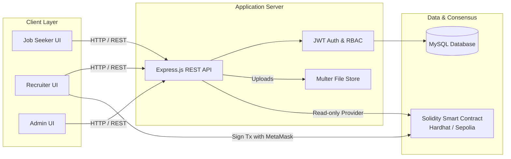
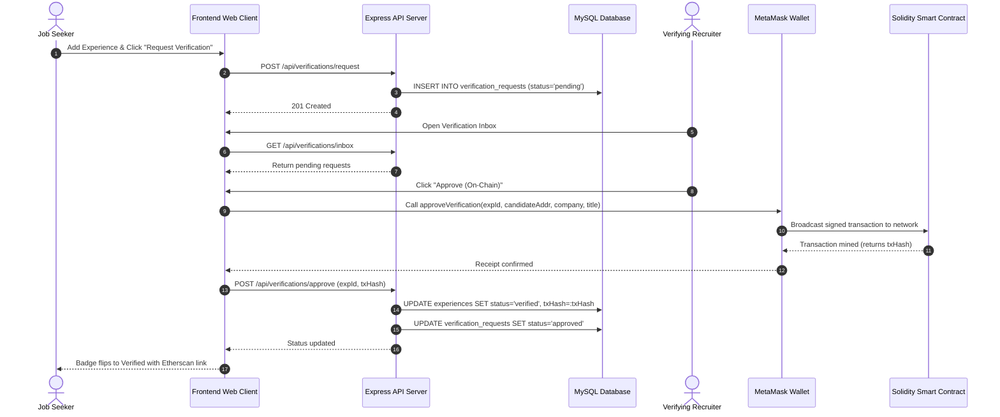
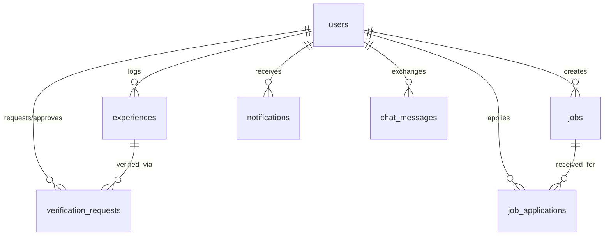

# ChainHire 2.0 — System Architecture & Technical Documentation

---

## Document Control & Metadata

| Field | Detail |
| :--- | :--- |
| **Project Title** | ChainHire 2.0 (Decentralized Employment Verification & Recruitment Platform) |
| **Document Version** | 2.0.0 |
| **Status** | Approved / Production Ready |
| **Target Audience** | Software Engineers, Web3 Architects, Technical Leads, System Administrators |
| **Last Updated** | October 2026 |

---

## 1. Executive Summary & System Overview

**ChainHire 2.0** is an enterprise-grade decentralized recruitment and cryptographic employment credential verification platform. Traditional hiring processes suffer from resume fraud, exaggerated titles, fake references, and prolonged manual background checks. 

ChainHire solves this by enabling candidates to register employment experiences and request cryptographic verification from verified employer representatives. The verifications are permanently recorded on the **Ethereum blockchain** through a **Solidity smart contract**. Once anchored on-chain, credentials cannot be forged, revoked unilaterally, or altered, offering trustless proof of work history for decentralized protocols and Web3 enterprises.



---

## 2. Development & Runtime Environment Specification

### 2.1 Technology Stack Matrix

| Tier | Component | Specification |
| :--- | :--- | :--- |
| **Frontend Runtime** | Browser Engine | HTML5, Vanilla JavaScript (ES6+ Modules), CSS3 |
| **Styling Framework** | CSS Engine | Tailwind CSS (Utility classes) + Custom Root Design Tokens |
| **Backend Runtime** | Node.js Engine | Node.js v18.0.0+ (Tested on Node.js v24.x) |
| **Web Server Framework** | HTTP Engine | Express.js 4.19.2 |
| **Database Management** | RDBMS | MySQL Server 8.0+ / MariaDB via `mysql2/promise` (Port 3306) |
| **Blockchain VM** | EVM | Solidity 0.8.20 + Hardhat 2.22.8 (Local Chain ID: `31337`) |
| **Web3 Client** | Client Library | Ethers.js v6.13.2 + Browser MetaMask Provider (`window.ethereum`) |
| **Authentication** | Cryptographic Auth | JSON Web Tokens (`jsonwebtoken` v9.0) + `bcryptjs` (Cost factor 10) |
| **File Storage** | Storage Engine | Multer 1.4.5 (Local disk storage under `/uploads`) |

### 2.2 Environment Variables Configuration

The backend environment is controlled by `.env`:

```env
# Application Server
PORT=5000
NODE_ENV=development

# Relational Database Connection (MySQL)
DB_HOST=127.0.0.1
DB_PORT=3306
DB_USER=root
DB_PASSWORD=
DB_NAME=chainhire_db

# Security Tokens
JWT_SECRET=chainhire_super_secure_secret_jwt_key_2026_x89f
JWT_EXPIRES_IN=7d

# Blockchain Network
HARDHAT_RPC_URL=http://127.0.0.1:8545
SEPOLIA_RPC_URL=https://rpc.sepolia.org
SEPOLIA_PRIVATE_KEY=
CONTRACT_ADDRESS=0x5FbDB2315678afecb367f032d93F642f64180aa3
```

---

## 3. Frontend Implementation Specification

The frontend architecture adheres to a clean, modular, zero-framework approach (Vanilla JavaScript ES6+), avoiding heavy frontend dependencies to maximize performance, maintainability, and direct DOM control.

### 3.1 Design System & Visual Tokens

The user interface follows a modern Web3 design language:
- **Primary Navy:** `#0F172A` (Background headers, active navigation, authority elements)
- **Emerald Accent:** `#10B981` (Verification badges, interactive buttons, success states)
- **Canvas Neutral:** `#F8FAFC` (Background container tone)
- **Card Neutral:** `#FFFFFF` (Surface cards with subtle border `#E2E8F0` and elevated shadows)
- **Alert States:**
  - Verified: `#10B981` (Emerald Green)
  - Pending: `#F59E0B` (Amber Orange)
  - Rejected: `#EF4444` (Crimson Red)

### 3.2 Directory & Page Structure (`frontend/pages/`)

| Page | File Path | Target Audience | Primary Purpose |
| :--- | :--- | :--- | :--- |
| **Landing Page** | `pages/index.html` | Public | Value proposition, feature highlights, call to actions |
| **Login** | `pages/login.html` | All Users | Role-specific authentication with 1-click test credential fill |
| **Register** | `pages/register.html` | All Users | Account creation with role selection (Candidate vs Recruiter) |
| **Seeker Dashboard** | `pages/seeker-dashboard.html`| Job Seeker | Profile statistics, experience timeline, verification request dispatch |
| **Recruiter Dashboard** | `pages/recruiter-dashboard.html`| Recruiter | Verification inbox, candidate approval via MetaMask, job posting tool |
| **Admin Overview** | `pages/admin-dashboard.html` | Admin | Platform metrics, user moderation table, account ban/unban toggles |
| **Jobs Board** | `pages/jobs.html` | Job Seeker | Job discovery feed, search and filter bar, 1-click application modal |
| **Applications** | `pages/applications.html` | Job Seeker / Recruiter | Tracking pipeline for job application submissions |
| **Settings** | `pages/settings.html` | All Users | Profile configuration, avatar upload, and MetaMask wallet binding |
| **Direct Messages** | `pages/messages.html` | All Users | Peer-to-peer real-time chat interface |

### 3.3 Core Client-Side Modules (`frontend/js/`)

1. **`config.js`**: Declares global endpoints, fallback contract addresses, and network identifiers.
2. **`api.js`**: Reusable HTTP request client with authorization header injection, unified error interceptor, and animated toast notification display.
3. **`auth.js`**: Manages browser `localStorage` credentials, token expiry validation, role routing guards, and dynamic navigation bar rendering.
4. **`web3.js`**: Interfaces with `window.ethereum` (MetaMask) and Ethers.js v6. Handles network verification, wallet connection, transaction signing, and transaction receipt confirmation.
5. **`seeker.js`**: Binds the candidate experience CRUD form, triggers verification requests, and displays verified transaction links.
6. **`recruiter.js`**: Loads pending verification tickets, manages applicant candidate lists, and triggers on-chain approval smart contract calls.

---

## 4. Backend Implementation Specification

The backend is built as an asynchronous Node.js Express service located in `backend/`.

```
backend/
├── config/
│   ├── db.js                 # MySQL pool connection and auto-migration
│   ├── blockchain.js         # Ethers.js provider and contract bindings
│   └── contractData.json     # Deployed contract address and ABI
├── controllers/
│   ├── authController.js     # User registration, login, profile, and wallet link
│   ├── experienceController.js # Experience CRUD
│   ├── verificationController.js # Verification workflow and on-chain syncing
│   ├── jobController.js      # Job postings and candidate applications
│   ├── chatController.js     # Peer-to-peer messages
│   └── adminController.js    # Statistics and user moderation
├── middleware/
│   ├── auth.js               # JWT bearer verification
│   ├── role.js               # Role-based access control (RBAC)
│   └── upload.js             # Multer file storage
├── routes/                   # Endpoint definitions
├── contracts/
│   └── EmploymentVerification.sol # Solidity registry contract
├── scripts/
│   └── deploy.js             # Hardhat deployment script
├── seed.js                   # Mock test data seeder
└── server.js                 # Server entry point
```

### 4.1 REST API Endpoint Specification

#### Authentication Endpoints (`/api/auth`)
- `POST /api/auth/register`: Create account (`fullName`, `email`, `password`, `role`, `company`).
- `POST /api/auth/login`: Authenticate credentials and return signed JWT.
- `GET /api/auth/profile`: Retrieve authenticated user details.
- `PUT /api/auth/profile`: Update profile info (headline, bio, phone, avatar).
- `PUT /api/auth/wallet`: Bind connected Ethereum address to user profile.

#### Experience Endpoints (`/api/experiences`)
- `GET /api/experiences`: Retrieve current candidate's experience list.
- `POST /api/experiences`: Create new experience record (`company`, `title`, `startDate`, `endDate`).
- `PUT /api/experiences/:id`: Modify an existing unverified experience.
- `DELETE /api/experiences/:id`: Remove an unverified experience.

#### Verification Endpoints (`/api/verifications`)
- `POST /api/verifications/request`: Dispatch a verification request to a recruiter for a specific experience.
- `GET /api/verifications/inbox`: Fetch incoming verification requests for the authenticated recruiter.
- `POST /api/verifications/approve`: Record successful blockchain transaction (`txHash`) and set experience status to `verified`.
- `POST /api/verifications/reject`: Reject a verification request with remarks.

#### Job Board Endpoints (`/api/jobs`)
- `GET /api/jobs`: Query active job listings with search/filtering parameters.
- `POST /api/jobs`: Recruiter creates a new job posting.
- `GET /api/jobs/:id/applications`: Recruiter fetches applicants for a specific job.
- `POST /api/jobs/:id/apply`: Candidate applies to a job, attaching a resume file and cover note.
- `PATCH /api/jobs/applications/:id/status`: Update candidate stage (`Applied`, `Shortlisted`, `Hired`, `Rejected`).

#### Administration Endpoints (`/api/admin`)
- `GET /api/admin/stats`: Get system metrics (total candidates, recruiters, verified credentials, jobs).
- `GET /api/admin/users`: Query user directory with status filters.
- `PATCH /api/admin/users/:id/toggle-block`: Suspend or reinstate user access.

---

## 5. Blockchain & Smart Contract Specification

The smart contract layer provides the trustless verification backbone, implemented in **Solidity 0.8.20** and compiled using Hardhat.

### 5.1 Smart Contract: `EmploymentVerification.sol`

```solidity
// SPDX-License-Identifier: MIT
pragma solidity 0.8.20;

contract EmploymentVerification {
    struct Verification {
        uint256 experienceId;
        address candidate;
        address verifier;
        string company;
        string title;
        uint256 verifiedAt;
        bool isVerified;
    }

    mapping(uint256 => Verification) public verifications;
    mapping(uint256 => address) public requestedVerifiers;
    address public owner;

    event VerificationRequested(uint256 indexed experienceId, address indexed candidate, address indexed verifier, uint256 timestamp);
    event VerificationApproved(uint256 indexed experienceId, address indexed candidate, address indexed verifier, string company, string title, uint256 verifiedAt);
    event VerificationRevoked(uint256 indexed experienceId, address indexed verifier, uint256 timestamp);

    function requestVerification(uint256 _experienceId, address _verifier) external {
        require(_verifier != address(0), "Invalid verifier address");
        requestedVerifiers[_experienceId] = _verifier;
        emit VerificationRequested(_experienceId, msg.sender, _verifier, block.timestamp);
    }

    function approveVerification(
        uint256 _experienceId, 
        address _candidate, 
        string calldata _company, 
        string calldata _title
    ) external {
        verifications[_experienceId] = Verification({
            experienceId: _experienceId,
            candidate: _candidate,
            verifier: msg.sender,
            company: _company,
            title: _title,
            verifiedAt: block.timestamp,
            isVerified: true
        });

        emit VerificationApproved(_experienceId, _candidate, msg.sender, _company, _title, block.timestamp);
    }

    function isExperienceVerified(uint256 _experienceId) external view returns (bool) {
        return verifications[_experienceId].isVerified;
    }

    function getVerification(uint256 _experienceId) external view returns (
        uint256 experienceId,
        address candidate,
        address verifier,
        string memory company,
        string memory title,
        uint256 verifiedAt,
        bool isVerified
    ) {
        Verification memory v = verifications[_experienceId];
        return (v.experienceId, v.candidate, v.verifier, v.company, v.title, v.verifiedAt, v.isVerified);
    }
}
```

### 5.2 Verification Lifecycle Workflow



---

## 6. Database Schema & Data Dictionary

The persistence layer uses MySQL with utf8mb4 encoding and foreign key relational constraints.

### 6.1 Entity Relationship Diagram



### 6.2 Data Dictionary

#### Table: `users`
| Column | Type | Nullable | Key | Default | Description |
| :--- | :--- | :--- | :--- | :--- | :--- |
| `id` | INT | No | PK | Auto | Unique user ID |
| `fullName` | VARCHAR(120) | No | | | User's full display name |
| `email` | VARCHAR(120) | No | Unique | | Authentication email |
| `password` | VARCHAR(255) | No | | | Bcrypt password hash |
| `phone` | VARCHAR(30) | Yes | | NULL | Contact phone number |
| `cnic` | VARCHAR(40) | Yes | | NULL | National identification code |
| `role` | ENUM | No | | 'jobSeeker' | Access role: `jobSeeker`, `recruiter`, `admin` |
| `company` | VARCHAR(120) | Yes | | '' | Employer name (for recruiters) |
| `walletAddress` | VARCHAR(60) | Yes | | NULL | Ethereum wallet address (`0x...`) |
| `headline` | VARCHAR(255) | Yes | | '' | Professional title summary |
| `bio` | TEXT | Yes | | NULL | Profile summary bio |
| `location` | VARCHAR(120) | Yes | | '' | City / Country |
| `avatar` | VARCHAR(255) | Yes | | '' | Avatar image URL/path |
| `isBlocked` | TINYINT(1) | No | | 0 | 1 if banned by admin, else 0 |
| `createdAt` | DATETIME | Yes | | CURRENT_TIMESTAMP | Registration timestamp |

#### Table: `experiences`
| Column | Type | Nullable | Key | Default | Description |
| :--- | :--- | :--- | :--- | :--- | :--- |
| `id` | INT | No | PK | Auto | Experience record ID |
| `userId` | INT | No | FK | | References `users(id)` ON DELETE CASCADE |
| `company` | VARCHAR(120) | No | | | Company name |
| `title` | VARCHAR(120) | No | | | Job title / designation |
| `startDate` | VARCHAR(30) | No | | | Tenure start date |
| `endDate` | VARCHAR(30) | Yes | | NULL | Tenure end date |
| `isCurrent` | TINYINT(1) | No | | 0 | 1 if currently employed |
| `description`| TEXT | Yes | | NULL | Key responsibilities & achievements |
| `status` | ENUM | No | | 'pending' | Verification status: `pending`, `verified`, `rejected` |
| `verifiedBy` | INT | Yes | FK | NULL | References `users(id)` of approving recruiter |
| `verifierName`| VARCHAR(120)| Yes | | NULL | Name of certifying official |
| `verifierCompany`| VARCHAR(120)| Yes | | NULL | Organization verifying record |
| `txHash` | VARCHAR(100) | Yes | | NULL | Ethereum transaction hash |

#### Table: `verification_requests`
| Column | Type | Nullable | Key | Default | Description |
| :--- | :--- | :--- | :--- | :--- | :--- |
| `id` | INT | No | PK | Auto | Request ticket ID |
| `experienceId`| INT | No | FK | | References `experiences(id)` ON DELETE CASCADE |
| `seekerId` | INT | No | FK | | References `users(id)` (Candidate) |
| `recruiterId`| INT | No | FK | | References `users(id)` (Verifier) |
| `status` | ENUM | No | | 'pending' | Status: `pending`, `approved`, `rejected` |
| `remarks` | TEXT | Yes | | NULL | Reason or verification notes |
| `txHash` | VARCHAR(100) | Yes | | NULL | Blockchain receipt hash |

#### Table: `jobs`
| Column | Type | Nullable | Key | Default | Description |
| :--- | :--- | :--- | :--- | :--- | :--- |
| `id` | INT | No | PK | Auto | Unique Job ID |
| `recruiterId`| INT | No | FK | | References `users(id)` (Poster) |
| `company` | VARCHAR(120) | No | | | Hiring company |
| `title` | VARCHAR(120) | No | | | Job title |
| `location` | VARCHAR(120) | No | | | Job location or 'Remote' |
| `jobType` | VARCHAR(40) | No | | 'Full-time'| Full-time, Part-time, Contract |
| `salaryMin` | INT | Yes | | 0 | Minimum base compensation |
| `salaryMax` | INT | Yes | | 0 | Maximum base compensation |
| `salaryText`| VARCHAR(100) | Yes | | '' | Formatted salary string |
| `description`| TEXT | Yes | | NULL | Full job overview |
| `requirements`| TEXT | Yes | | NULL | Required skills & experience |
| `logoBg` | VARCHAR(30) | Yes | | '#0F172A'| Badge background color code |
| `isActive` | TINYINT(1) | No | | 1 | 1 for open, 0 for closed |

#### Table: `job_applications`
| Column | Type | Nullable | Key | Default | Description |
| :--- | :--- | :--- | :--- | :--- | :--- |
| `id` | INT | No | PK | Auto | Unique Application ID |
| `jobId` | INT | No | FK | | References `jobs(id)` ON DELETE CASCADE |
| `seekerId` | INT | No | FK | | References `users(id)` (Applicant) |
| `resumeUrl` | VARCHAR(255) | Yes | | NULL | Relative path to uploaded resume PDF |
| `coverNote` | TEXT | Yes | | NULL | Applicant cover letter |
| `status` | ENUM | No | | 'Applied' | Stage: `Applied`, `Shortlisted`, `Rejected`, `Hired` |
| `appliedAt` | DATETIME | Yes | | CURRENT_TIMESTAMP | Application submission timestamp |

---

## 7. Security, Access Control & RBAC

1. **Password Hashing:** Passwords are salted and hashed using `bcryptjs` with 10 salt rounds before storage. Plaintext passwords are never logged or stored.
2. **JWT Transport Security:** Tokens contain an expiration timestamp (`7d`) and are digitally signed with a cryptographic secret.
3. **Role-Based Authorization:** Every sensitive API endpoint checks user permissions via `backend/middleware/role.js`:
   - Only `jobSeeker` can create and submit verification requests or apply for jobs.
   - Only `recruiter` can approve verifications or post job listings.
   - Only `admin` can ban accounts or query platform telemetry.
4. **Account Suspension Checks:** On every authenticated request, the database validates `isBlocked == 0`. Banned accounts immediately receive an HTTP 403 Forbidden.

---

## 8. Runbook & Execution Guide

### 8.1 Prerequisites
- MySQL Server running on `127.0.0.1:3306`
- Node.js (v18+)

### 8.2 Execution Commands

```bash
# 1. Navigate to backend
cd chainhire-v2/backend

# 2. Install dependencies (if not already installed)
npm install

# 3. Seed database with realistic demo accounts and jobs
npm run seed

# 4. Start local Hardhat blockchain node (Terminal 1)
npm run node:hardhat

# 5. Deploy smart contract to local blockchain (Terminal 2)
npm run deploy:local

# 6. Start the Express API and frontend server (Terminal 2)
npm start
```

### 8.3 Live Application URLs
- **Web Application Portal:** [http://localhost:5000](http://localhost:5000)
- **Login Portal:** [http://localhost:5000/pages/login.html](http://localhost:5000/pages/login.html)
- **Hardhat Blockchain Node:** `http://127.0.0.1:8545`
- **Smart Contract Address:** `0x5FbDB2315678afecb367f032d93F642f64180aa3`

### 8.4 Demo Accounts
- **Candidate:** `alex.morgan@example.com` / `password123`
- **Recruiter:** `sophia.lee@chainhire.io` / `password123`
- **Platform Admin:** `admin@chainhire.io` / `password123`
